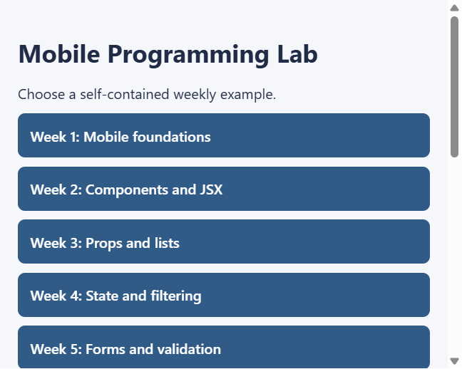
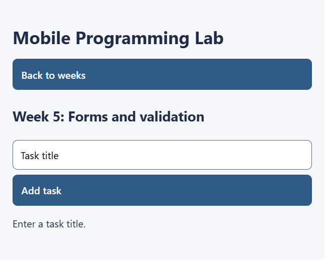

# Mobile Application Programming - Spring 2027

This Expo app contains 14 original, selectable weekly examples. Open this
folder in VS Code, install Node.js 26, and run:

```powershell
npm ci
npm test
npx expo install --check
npm start
```

If PowerShell's execution policy blocks `npm` or `npx`, use `npm.cmd` and
`npx.cmd` instead; no execution-policy change is needed.

## App preview

The web build presents a scrollable selector for the weekly examples:



For example, week 5 shows validation feedback for an empty task:



See the [weekly example guide](src/weeks/README.md) for another screen and
the source layout.

Choose a week from the app's menu. The project uses Expo SDK 57 because Expo's
November 2026 guidance identifies that SDK as compatible with Expo Go during
the SDK 58 transition. Expo Go compatibility changes; check the
[current setup guide](https://docs.expo.dev/get-started/create-a-project/)
before the semester. A development build can be needed for native modules or
an older SDK. iOS simulators require macOS.

The web export and weekly UI flows have been tested on Windows. Android,
iOS, screen readers and production builds still require device testing. The
week 9 network example uses a deterministic fixture, and week 14 keeps tasks
in memory. Week 10 uses local device storage and reports failures.

## Author examples and course examples

Each week's original example is in `src/weeks/week-NN.js`; the entry menu is
in `src/weeks.js`. The textbook's web examples are linked for concepts and
must not be confused with React Native components. The mobile chapters are
from the instructor's [React Projects fork](https://github.com/jpcst52/React-Projects-Second-Edition);
Chapter 8 has been migrated from SDK 44 to SDK 57 and tested in a Windows
browser. Chapter 9 has also been migrated and its login, post-detail and
logout flows tested in a Windows browser; image selection needs device testing.
Chapter 1's web example has been updated and browser-tested with simulated
API responses; see its [setup notes](https://github.com/jpcst52/React-Projects-Second-Edition/blob/main/Chapter01/SPRING-2027.md)
for dependency and bundle-size warnings.

| Week | Course example | Textbook author material |
|---|---|---|
| 1 | Mobile foundations | [Chapter 8](https://github.com/jpcst52/React-Projects-Second-Edition/tree/main/Chapter08) |
| 2 | Components and JSX | [Chapter 1](https://github.com/jpcst52/React-Projects-Second-Edition/tree/main/Chapter01), [Chapter 8](https://github.com/jpcst52/React-Projects-Second-Edition/tree/main/Chapter08) |
| 3 | Props and lists | [Chapter 2](https://github.com/jpcst52/React-Projects-Second-Edition/tree/main/Chapter02) |
| 4 | State and filtering | [Chapter 3](https://github.com/jpcst52/React-Projects-Second-Edition/tree/main/Chapter03) |
| 5 | Form validation | [Chapter 5](https://github.com/jpcst52/React-Projects-Second-Edition/tree/main/Chapter05) |
| 6 | Screen flow | [Chapter 9](https://github.com/jpcst52/React-Projects-Second-Edition/tree/main/Chapter09) |
| 7 | Responsive layout | [Chapter 8](https://github.com/jpcst52/React-Projects-Second-Edition/tree/main/Chapter08) |
| 8 | Accessible interaction | [Chapter 6](https://github.com/jpcst52/React-Projects-Second-Edition/tree/main/Chapter06) |
| 9 | Loading and errors | [Chapter 9](https://github.com/jpcst52/React-Projects-Second-Edition/tree/main/Chapter09) |
| 10 | Local persistence | [Chapter 9](https://github.com/jpcst52/React-Projects-Second-Edition/tree/main/Chapter09) |
| 11 | Release checklist | [Chapter 8](https://github.com/jpcst52/React-Projects-Second-Edition/tree/main/Chapter08) |
| 12 | Project vertical slice | [Chapter 8](https://github.com/jpcst52/React-Projects-Second-Edition/tree/main/Chapter08) |
| 13 | Project data states | [Chapter 9](https://github.com/jpcst52/React-Projects-Second-Edition/tree/main/Chapter09) |
| 14 | Project task flow | [Chapter 9](https://github.com/jpcst52/React-Projects-Second-Edition/tree/main/Chapter09) |

The author code is linked rather than copied here. The instructor's fork has
not yet been verified on Android or iOS with a current Expo Go app. Its older
web chapters other than Chapter 1 have not been verified with this course's
Node version.

## Dependency review

As of November 2026, `npm audit --omit=dev` reports three moderate findings in
Expo's fingerprint dependency chain involving `minimatch`. The suggested
forced fix downgrades Expo incompatibly; do not apply it blindly. Review Expo
and dependency updates before distributing the course setup.
