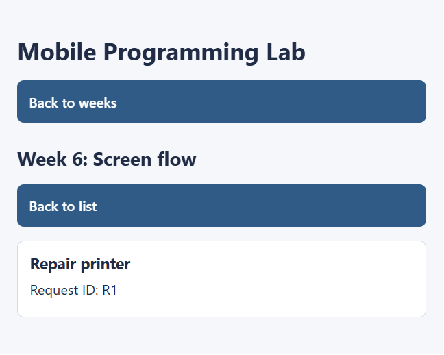

# Weekly mobile examples

Each `week-NN.js` file exports one original React Native example. The
[week registry](../weeks.js) supplies its menu title and component; the
[app entry point](../../App.js) displays the selected example.

Week 6 demonstrates navigating from a list to a detail view using synthetic
request data:

Return to the [course README](../../README.md) for setup, tests, author
material and device-testing limitations. Week 9 uses a network fixture, week
10 uses local storage, and week 14 keeps tasks in memory.
